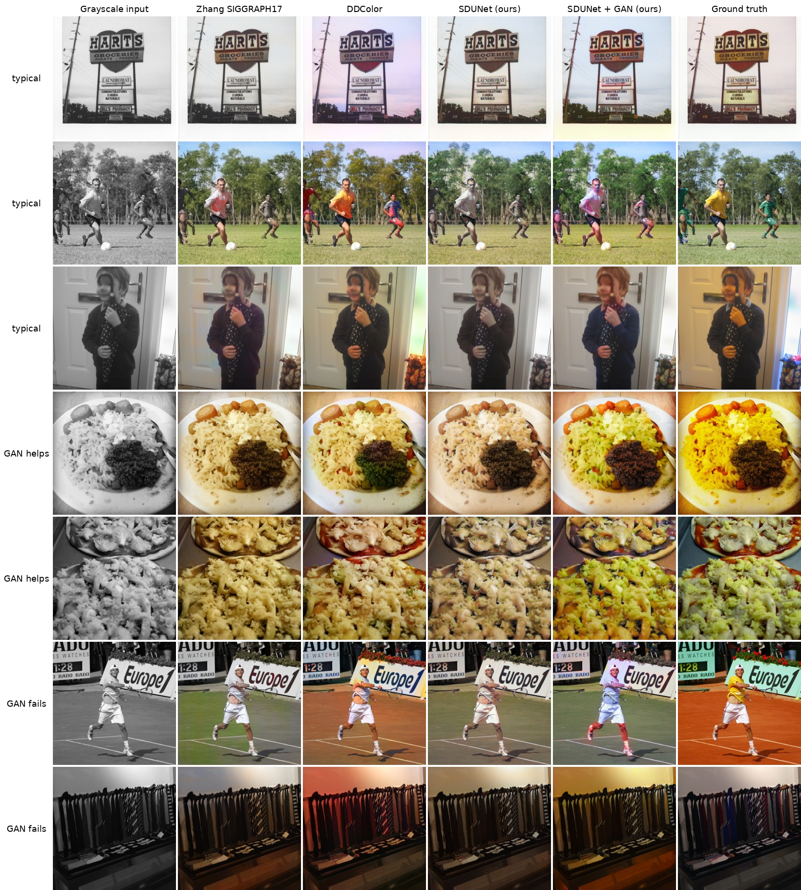

# Image-Colorization

Learned image colorization with a lightweight diffusion / GAN head (CSE 681).

[](https://colab.research.google.com/drive/1yJBFjaqxmEywGglq4SRV7dnocT0v_SKN?usp=sharing)

A grayscale photo goes in and a colour photo comes out. The model only predicts colour (the Lab *ab* channels);
the brightness (*L*) is always the input's own, so no detail is lost. It is built on a frozen Stable Diffusion
model (InstructPix2Pix) run in **one step**, adapted with small LoRA layers (4.7M trainable parameters), and
then sharpened in colour with a GAN critic built on DINOv2.




## Results

1,000 COCO test images, 256x256. 

Read more: [docs/evaluation.md](docs/evaluation.md).

| Method | FID ↓ | KID ↓ | Colourfulness (GT 43.1) | PSNR ↑ | SSIM ↑ | LPIPS ↓ | AuC-balanced ↑ |
|---|---|---|---|---|---|---|---|
| Grayscale input | 58.3 | 0.0245 | 0.0 | 22.48 | 0.916 | 0.225 | 0.757 |
| Zhang et al. 2016 (ECCV) | 56.1 | 0.0163 | 38.4 | 22.25 | 0.908 | 0.225 | 0.813 |
| Zhang et al. 2017 (SIGGRAPH) | 43.6 | 0.0061 | 29.3 | 24.07 | 0.926 | 0.176 | 0.813 |
| DDColor (ICCV 2023) | 29.0 | 0.0009 | 42.4 | 23.26 | 0.909 | 0.177 | 0.829 |
| SDUNet (ours, no GAN) | 39.8 | 0.0038 | 22.3 | 23.98 | 0.919 | 0.182 | 0.801 |
| SDUNet + GAN, w_adv 0.05 (ours) | 35.8 | 0.0015 | 28.0 | 23.60 | 0.911 | 0.188 | 0.804 |
| **SDUNet + GAN, w_adv 0.2 (ours, final)** | 35.4 | 0.0011 | 33.5 | 23.14 | 0.906 | 0.195 | 0.804 |


## Method

| Part | What it is |
|---|---|
| Backbone | InstructPix2Pix (Stable Diffusion 1.5) run once at t = 999: `x0 = (z − √(1−ᾱ)·ε) / √ᾱ`, no sampling loop |
| Conditioning | GrayCLIP: CLIP ViT-B/32 distilled to read grayscale images (`scripts/distill_clip.py`), plus the text "Colorize the photo" |
| Adapters | LoRA on the UNet attention (rank 16) and on the VAE decoder (rank 8); zero-initialised skip convs from the VAE encoder to the decoder |
| Phase B loss | 1.0 · L1(ab) + 1.0 · LPIPS(alex) + 0.1 · rebalanced 313-bin colour cross-entropy (Zhang et al. 2016) on decoder features |
| Phase C (GAN) | + w_adv · hinge loss from a discriminator: frozen DINOv2-S, trainable per-patch heads on blocks 3/6/9/12, conditioned on the grayscale input, DiffAugment |
| Training | COCO, 8k train / 1k val / 1k test; AdamW, warm-up + cosine, batch 2 × 4 accumulation, bf16; RTX 3060 6 GB. Phase B 12 epochs (~9 h), Phase C 4 epochs (~3 h) |

## Setup

```bash
pip install -e .                 # core
pip install -e ".[baselines]"    # DDColor (OpenCV), FID / KID
git submodule update --init      # baselines/zhang2016, baselines/ddcolor, baselines/sd_lora
python scripts/download_coco.py  # data/coco: images + train/val/test splits (gray photos filtered out)
```

## Usage

**Colourise your own images** (any size; colour predicted at 256, applied to the full-resolution *L*).
No local GPU? Use the [Colab notebook](https://colab.research.google.com/drive/1yJBFjaqxmEywGglq4SRV7dnocT0v_SKN?usp=sharing).

```bash
color_image-infer photo.jpg                          # -> runs/infer/photo.png
color_image-infer my_folder/ --out results/ --side-by-side
```
from Python:
```python
from PIL import Image
from color_image.infer import Colorizer
Colorizer()(Image.open("photo.jpg")).save("photo_color.png")    # default: runs/phase_c_w02/g_ep04.pt
```

**Train**

```bash
python scripts/distill_clip.py                       
python scripts/make_prior.py --n 8000               
python scripts/train.py
python scripts/train.py --gan --w-adv 0.2 --out runs/phase_c_w02
```
Each run writes `log.csv`, `samples/epoch_XX.png` (gray / prediction / truth), `best.pt` and `last.pt`
(`--resume runs/.../last.pt`); GAN runs also keep every epoch as `g_epXX.pt`.

**Evaluate**

```bash
python scripts/predict.py ours --ckpt runs/phase_b/best.pt --name SDUNet
python scripts/predict.py ours --ckpt runs/phase_c_w02/g_ep04.pt --name gan_w02
python scripts/predict.py ddcolor                    
python scripts/predict.py zhang --variant siggraph17

python scripts/evaluate.py --realism --pred SDUNet=runs/preds/SDUNet gan_w02=runs/preds/gan_w02 \
    ddcolor=runs/preds/ddcolor_paper siggraph17=runs/preds/zhang_siggraph17
```
`evaluate.py --n N` scores only the first N images.

## Repository structure

```
Image-Colorization/
├── baselines/                 
│   ├── zhang2016/             
│   ├── ddcolor/               
│   └── sd_lora/               
├── color_image/
│   ├── assets/                
│   ├── model.py               
│   ├── disc.py                
│   ├── losses.py              
│   ├── train.py               
│   ├── infer.py               
│   ├── metrics.py             
│   ├── baseline.py            
│   ├── common.py, data.py, config.py
├── scripts/                   download_coco, distill_clip, make_prior, train, predict, evaluate,
│                              eval_explorer
└── docs/                      evaluation protocol, figures
```
