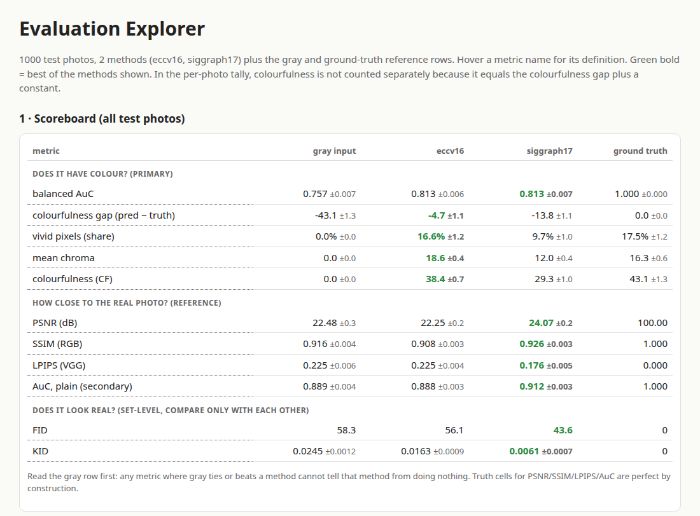
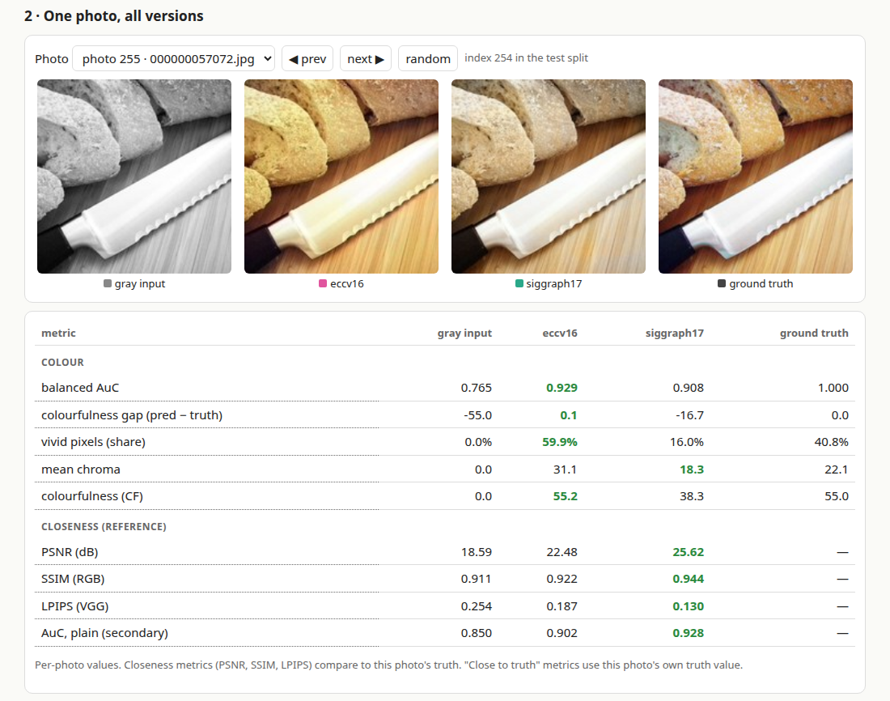
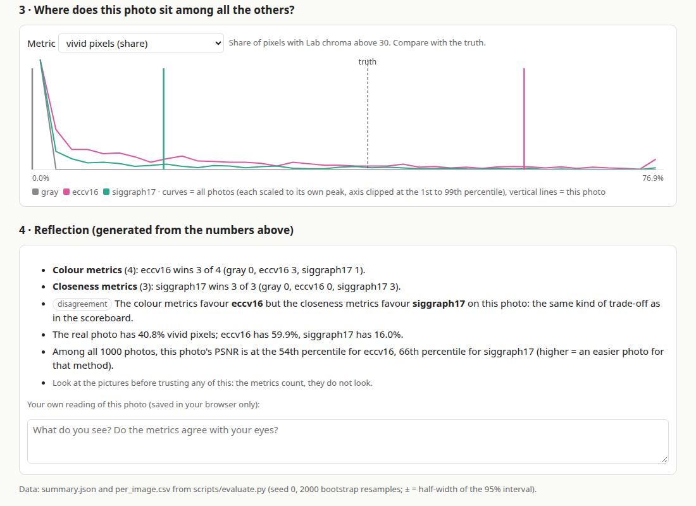

# Evaluation explorer

An interactive, single-file HTML page for reading the results of `scripts/evaluate.py`: the scoreboard, then one photo
at a time with all methods side by side, and where that photo sits among the whole test split. It works for any
number of methods, so new models are added by passing their prediction folders.

## Quick start
1. Score your methods (this writes `summary.json` and `per_image.csv`; add `--realism` for FID and KID):
   ```bash
   python scripts/evaluate.py --pred eccv16=runs/baselines_test1000/eccv16 \
       siggraph17=runs/baselines_test1000/siggraph17 --realism
   ```
2. Build the page with the **same `--pred` arguments**:
   ```bash
   python scripts/eval_explorer.py --pred eccv16=runs/baselines_test1000/eccv16 \
       siggraph17=runs/baselines_test1000/siggraph17
   ```
   It writes `runs/eval/explorer.html` (about 2 MB, self-contained, nothing is uploaded anywhere).
3. Open it. Double-clicking the file works in most browsers; if yours blocks local files, serve the folder:
   ```bash
   cd runs/eval && python -m http.server 8000 --bind 127.0.0.1
   ```
   then browse to `http://127.0.0.1:8000/explorer.html`.

| Option | Default | Meaning |
|---|---|---|
| `--pred [name=]dir ...` | required | the prediction folders given to `evaluate.py` |
| `--eval DIR` | `runs/eval` | folder containing `summary.json` and `per_image.csv` |
| `--samples N` | 30 | photos embedded in the page (chosen evenly along the PSNR gap between the first two methods) |
| `--thumb PX` | 176 | thumbnail size |
| `--out FILE` | `<eval>/explorer.html` | output path |

Deep links select a photo and a metric: `explorer.html?photo=254&metric=vivid_share` (`photo` is the index in the
split, shown as "index N" on the page; `metric` is a column name from `per_image.csv`).

## Tour

### 1. Scoreboard


The same numbers `evaluate.py` prints, grouped by the question they answer: does it have colour (primary), how close
is it to the real photo (reference), does it look real (FID and KID, only if `--realism` was used). Hover a metric
name for its definition. The best of the methods in each row is green and bold; ties go to the first method.
Read the **gray** row first: a metric where gray ties or beats a method cannot tell that method from doing nothing.

### 2. One photo, all versions


Pick a photo (menu, prev/next, or random). The images are the gray input, each method and the ground truth; the table
gives that photo's own metric values, with the same best-of highlighting.

### 3. Where does this photo sit?, and 4. Reflection


The curves show each method's distribution of the chosen metric over the whole split (each curve scaled to its own
peak, axis clipped at the 1st to 99th percentile); the vertical lines are this photo. The reflection is generated
from the numbers: which method wins the colour and the closeness groups, where they disagree, whether a method
scores below plain gray on PSNR/SSIM, and where the photo's PSNR falls in each method's distribution. The note box
under it is saved in the browser only (not in the repo).

## Adding a new method
The explorer only needs what `evaluate.py` needs: **a folder of `<image-stem>.png` files, one per test photo, at the
split's resolution (center crop, 256x256 by default)**. Run `evaluate.py` and `eval_explorer.py` with the extra
`name=folder` argument. Nothing else changes, so it fits whatever training and inference pipeline produces those
folders. The method names given to `--pred` must be the same in both commands (the script stops with a clear message
otherwise).

## Limits
- Only `--samples` photos are embedded (the distributions use all of them). The page size grows with the number of
  methods times the number of photos.
- The reflection counts metric values; it does not look at the images. Check the pictures.
- Up to six methods get distinct colours; beyond that colours repeat. Many methods make the tables wide (they scroll).
- Colourfulness is shown in the tables but not counted separately in the tally: it equals the colourfulness gap plus
  a constant, so it would double-count.
- The page reads the existing `summary.json`; if you re-run `evaluate.py`, rebuild the page.
